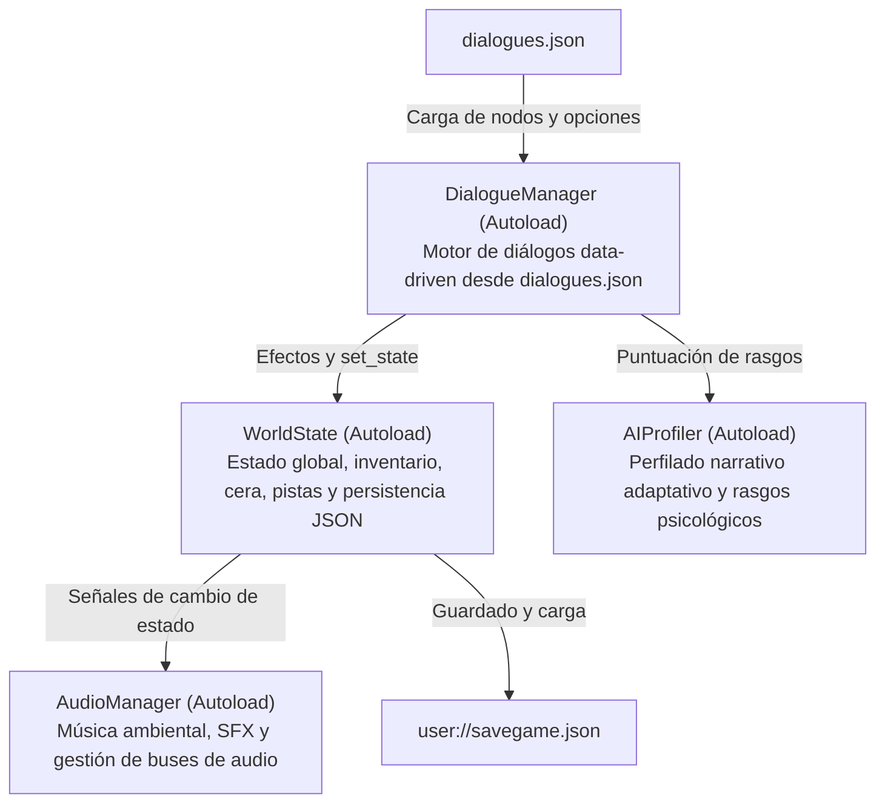

# El Guardián de las Páginas en Blanco: Crónicas de Aldeavieja

> Una aventura narrativa 2D en vista cenital (*top-down*) desarrollada en **Godot Engine 4** con estética *pixel-art* cálida, iluminación ambiental y una profunda reflexión sobre la memoria colectiva, el duelo y el olvido.

---

## Jugar en línea

¡Puedes jugar la aventura directamente desde tu navegador sin necesidad de instalar nada!

🎮 **Versión web en itch.io:** [El Guardián de las Páginas en Blanco en itch.io](https://ana099.itch.io/el-guardin-de-las-pginas-en-blanco)

* **Compatibilidad:** Se ejecuta directamente en el navegador web (compatible con **Windows** y **macOS**).
* **Soporte bilingüe:** Totalmente jugable en **Español** e **Inglés** (**ES/EN**) con alternancia de idioma en tiempo real.

---

## 📖 Sinopsis

En el pueblo de **Aldeavieja**, los recuerdos compartidos han comenzado a disiparse como tinta lavada por la lluvia. Tras el fallecimiento de su abuelo, maestro encuadernador del pueblo, el protagonista regresa a su antiguo taller para descubrir que ha heredado una responsabilidad ancestral: convertirse en el **Guardián de las Páginas en Blanco**.

Equipado con un cuaderno mágico encuadernado a mano y el calor de una vela de cera dorada, el jugador deberá recorrer las calles de Aldeavieja, descifrar los ecos del pasado, proteger los recuerdos amenazados por una presencia espectral llamada *El Desvanecido* y decidir qué relatos merecen ser preservados para siempre en la memoria compartida.

---

## ✨ Características Principales

* **Creador de personajes inclusivo y personalizable:** Permite personalizar la apariencia del protagonista (tonos de piel, cabello y vestimenta) con sincronización inmediata en los sprites del mundo.
* **Prólogo interactivo:** Introducción atmosférica ambientada en el taller de encuadernación en plena noche de tormenta, donde se aprende el uso de la cera y el cuaderno.
* **Tres niveles con mecánicas y ritmos diferenciados:**
  * **Nivel 1 (Plaza Central de Aldeavieja):** Investigación conversacional no lineal con pistas entrelazadas (relojería de Don Elías, floristería de Marta, antiguo puente y panadería) y diálogos reactivos para reconstruir el recuerdo de Lucía y Tomás.
  * **Nivel 2 (Antigua Estación de Tren):** Evasión y tensión ante *El Desvanecido*. Uso estratégico de distracciones del entorno (farola deslumbrante, barricada de herramientas, tañido de la campana de latón y palanca de cambio de vías) para acceder a la torre del reloj y salvar la memoria de Samuel.
  * **Nivel 3 (Casa Familiar del Abuelo):** Deducción y reconstrucción íntima de recuerdos mediante objetos cargados de memoria (jardín, estudio de encuadernación y habitación principal) antes de alcanzar el santuario final.
* **Menú de pausa con Diario del Cuaderno de Cera:** Panel integral accesible en cualquier momento (`Esc`) que recopila el inventario de pistas, páginas desbloqueadas, decisiones trascendentales y progreso de la aventura.
* **Sistema de audio dinámico y buses independientes:** Paisaje sonoro ambiental cálido y efectos (SFX) sintetizados proceduralmente, controlados a través de tres buses de audio (`Master`, `Music` y `SFX`) ajustables en tiempo real tanto en el menú principal como en la pausa.
* **Soporte bilingüe integral en tiempo real (Español / Inglés):** Motor de localización reactivo (`LocaleManager`) que permite alternar el idioma de forma instantánea en cualquier punto de la partida (menús, HUDs de los 3 niveles, objetivos, los 56 nodos de diálogo y el Diario del Cuaderno de Cera) sin necesidad de reiniciar.
* **Tres finales narrativos adaptativos:** Desenlaces dinámicos calculados a través del perfilador narrativo (`AIProfiler`), reflejando las decisiones éticas y emocionales del jugador frente a la memoria y el paso del tiempo.

---

## 🎮 Controles

| Acción | Teclas Primarias | Teclas Alternativas |
| :--- | :--- | :--- |
| **Moverse (Arriba, Abajo, Izquierda, Derecha)** | `W`, `A`, `S`, `D` | `↑`, `↓`, `←`, `→` |
| **Interactuar / Hablar / Examinar** | `E` | — |
| **Cuaderno de Cera (Revelar pistas y secretos)** | `Q` | — |
| **Menú de Pausa / Diario / Opciones** | `Esc` | — |
| **Guardado Rápido** | `G` | Botón «Guardar Partida» en pausa |

---

## 🏛️ Arquitectura Técnica

El proyecto sigue una arquitectura desacoplada basada en nodos, recursos y *Autoloads* (Singletons) en **Godot Engine 4 (GDScript)** con tipado estático estricto:



* **`WorldState.gd` (`Autoload`):** Administrador del estado reactivo del juego, sistema de guardado y carga persistente (`user://savegame.json`), contadores de pistas, memoria y cera.
* **`AIProfiler.gd` (`Autoload`):** Registra el peso de las elecciones del jugador a lo largo del viaje para modular la respuesta narrativa y calcular el epílogo.
* **`DialogueManager.gd` (`Autoload`) & `dialogues.json`:** Sistema modular de diálogos *data-driven* con bifurcaciones, condiciones de estado, asignación de pistas y efectos en tiempo real.
* **`AudioManager.gd` (`Autoload`):** Controlador sonoro continuo con soporte para recuperación ante restricciones de *autoplay* en plataformas web (HTML5) y enlace a señales de progresión.
* **`LocaleManager.gd` (`Autoload`):** Motor de internacionalización y localización en vivo (Español / Inglés) con persistencia de configuración (`user://settings.cfg`), traducción de interfaces y alternancia dinámica de diálogos.
* **`InspectableObject.gd` & `NPC.gd`:** Entidades interactivas que gestionan destellos de cera dorada, retroalimentación visual en pantalla y diálogos de seguimiento reactivos sin repetición.

---

## 🚀 Cómo Ejecutar el Proyecto

1. **Requisitos:** Tener instalado **[Godot Engine 4.2+](https://godotengine.org/)** (versión Standard).
2. **Descarga o Clonación:**
   ```bash
   git clone https://github.com/rualesana-046/Proyecto_videojuego_2D.git
   ```
3. **Abrir en Godot:**
   * Abre Godot Engine.
   * Haz clic en **Importar** (*Import*) y selecciona el archivo `project.godot` de la carpeta raíz del repositorio.
4. **Ejecutar:**
   * Presiona **F5** (o el botón *Play* en la esquina superior derecha) para iniciar desde el menú principal (`scenes/ui/MainMenu.tscn`).

---

## 📜 Créditos

* **Desarrollo:**  
  Ana María Ruales  
  *Programación y arquitectura en Godot Engine 4 (GDScript)*

* **Diseño narrativo:**  
  Ana María Ruales  
  *Historia original, diálogos y sistema de decisiones*

* **Diseño visual:**  
  Ana María Ruales  
  *Dirección de arte, interfaz ornamental y sprites 2D*  
  *Ilustraciones conceptuales asistidas con Gemini*  
  *Tipografías Almendra y Lora (Google Fonts)*

* **Música y sonido:**  
  *Audio ambiental y efectos (SFX) sintetizados proceduralmente*

* **Agradecimientos:**  
  Materia: *Diseño de interfaces de software*  

  **Pruebas de jugabilidad:**  
  Juan Ruales · Luisa Arteaga · Danilo Zamora · Stefany Portillo · Daniela Arias
